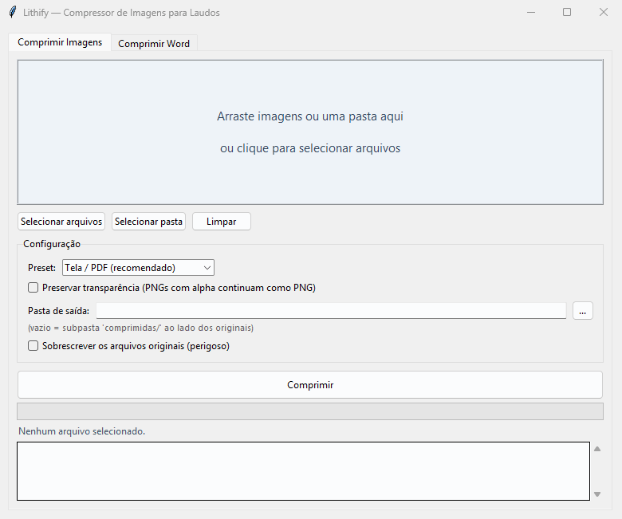
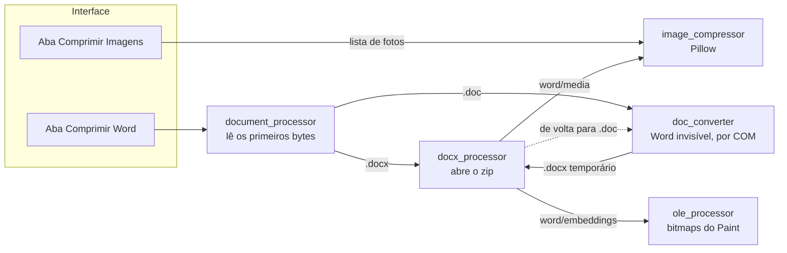

# Lithify



*Seis fotos de 4608×3456 px, com 6 a 7 MB cada, no preset Tela / PDF. As fotos são de [JFVelasquez Floro](https://commons.wikimedia.org/wiki/User:JFVelasquez_Floro), no Wikimedia Commons, em domínio público (CC0).*

O Lithify é um programa para Windows que comprime as fotos de laudos técnicos feitos no Word. Ele reduz as fotos antes de elas entrarem no documento e, quando o documento já está pronto, comprime as imagens que estão dentro do `.docx` ou do `.doc`. No preset padrão, as fotos ficam com no máximo 1920 px no lado maior.

**[Baixar o Lithify.exe](https://github.com/vitor-brack/Lithify/releases/latest)** para Windows de 64 bits. É um arquivo só, que abre sem instalar nada.

## Por que existe

Fiz o Lithify para o meu pai, que é geólogo e monta laudos técnicos no Word com muitas fotos de campo. Um desses laudos chegou a 689 MB: o Word ficava lento e o arquivo era grande demais para mandar por e-mail. Parte do peso vinha de fotos coladas como "Imagem de bitmap" do Paint, que o Word guarda sem nenhuma compressão. Com o Lithify, o mesmo laudo caiu para 73 MB.

O nome vem de litificação, o processo geológico em que sedimentos soltos são compactados até virar rocha.

## O que dá para fazer

- Arrastar fotos ou uma pasta para a janela, inclusive com subpastas, e comprimir tudo de uma vez. Os formatos aceitos são JPEG, PNG, BMP, TIFF e WebP
- Escolher entre três presets: **Tela / PDF** (1920 px e qualidade 82), **Impressão** (2500 px e qualidade 88) ou **Personalizado** (de 720 a 4000 px e qualidade de 60 a 95)
- Salvar as fotos comprimidas numa subpasta `comprimidas/`, numa pasta à escolha ou, depois de uma confirmação, por cima das originais
- Comprimir um `.docx` ou um `.doc` pronto. O resultado sai numa subpasta `comprimidos/`, com o mesmo nome e o mesmo formato do original
- Reduzir as fotos coladas como "Imagem de bitmap" do Paint. O clique duplo na imagem continua abrindo o Paint
- Manter a transparência dos PNGs, se a opção estiver marcada. Sem ela, o PNG vira JPEG com fundo branco

## Stack

- Python 3.10 ou mais novo
- Tkinter (ttk) para a interface e [tkinterdnd2](https://github.com/Eliav2/tkinterdnd2) para arrastar e soltar
- [Pillow](https://python-pillow.org/) para redimensionar e recomprimir as fotos
- `zipfile`, da biblioteca padrão, para abrir e regravar o `.docx`
- [olefile](https://github.com/decalage2/olefile) para ler os objetos OLE, e a Structured Storage do Windows, pelo [pywin32](https://github.com/mhammond/pywin32), para regravá-los
- pywin32 também para controlar o Microsoft Word por COM na conversão de `.doc`
- pytest, com 38 testes, e GitHub Actions no Windows com Python 3.10 e 3.13
- PyInstaller, que gera o `Lithify.exe`

## Como funciona



A interface roda a compressão numa thread separada e lê o progresso por uma fila a cada 100 ms, por isso a janela não trava durante um lote grande. As duas abas usam o mesmo `image_compressor`. Na aba do Word, o `document_processor` reconhece o formato pelos primeiros bytes do arquivo (`PK` do zip no `.docx` e `D0 CF 11 E0` do compound file no `.doc`) e só olha a extensão quando eles não batem com nenhum dos dois. O `.doc` passa pelo Word, que o converte num `.docx` temporário; depois da compressão, o Word converte de volta.

| Módulo | O que faz |
|---|---|
| `main.py` | Ponto de entrada. Grava o log em `%APPDATA%\Lithify\lithify.log` e aceita `--debug` |
| `gui/main_window.py` | As duas abas, a thread de trabalho e a fila de progresso |
| `core/image_compressor.py` | Comprime uma foto ou um lote. Gira a foto pela orientação do EXIF, reduz o lado maior com LANCZOS e salva um JPEG progressivo sem o EXIF |
| `core/document_processor.py` | Reconhece o formato do documento e chama o caminho do `.docx` ou do `.doc` |
| `core/docx_processor.py` | Recomprime as fotos de `word/media/` e passa os objetos de `word/embeddings/` para o `ole_processor` |
| `core/ole_processor.py` | Reduz o bitmap guardado num objeto OLE do Paint e remonta o objeto |
| `core/doc_converter.py` | Abre o Word invisível para converter `.doc` em `.docx` e de volta |
| `core/exceptions.py` | Os erros do projeto, como `WordNotAvailableError` |

## Como rodar

Precisa do Windows e do Python 3.10 ou mais novo.

```powershell
git clone https://github.com/vitor-brack/Lithify.git
cd Lithify
python -m venv .venv
.\.venv\Scripts\Activate.ps1
pip install -r requirements.txt
python main.py
```

Com `python main.py --debug`, o log detalhado aparece também no console.

### Testes

```powershell
python -m pytest -v
```

Os 38 testes montam em memória os documentos que usam, com `zipfile`, Pillow e a Structured Storage, então o repositório não guarda nenhum documento de exemplo. O teste que converte um `.doc` de ida e volta precisa do Word e é pulado quando ele não está instalado. É o que acontece no GitHub Actions, que roda os outros 37 a cada push.

### Gerar o executável

```powershell
pyinstaller --onefile --windowed --name Lithify --collect-all tkinterdnd2 --collect-submodules win32com --collect-submodules pythoncom --hidden-import olefile --noconfirm main.py
```

O `Lithify.exe` sai em `dist\`, com uns 25 MB. O `--collect-all tkinterdnd2` inclui a DLL nativa do arrastar e soltar, e os dois `--collect-submodules` incluem as partes do pywin32 que o Word e a Structured Storage usam.

## Decisões de projeto (e por quê)

### 1. Comprimir antes de montar o documento

O caminho recomendado é comprimir as fotos antes de inseri-las. Assim o Pillow trabalha direto nos arquivos, e o Word nem precisa estar instalado. A aba **Comprimir Word** existe para quando o documento já foi montado com as fotos originais.

### 2. O `.docx` aberto como zip

Um `.docx` é um arquivo zip. O Lithify recomprime só as fotos de `word/media/` e copia o resto como está, inclusive o XML do texto. Os nomes das fotos não mudam, mesmo quando um PNG vira JPEG, então nenhuma referência dentro do documento precisa ser reescrita. Imagens vetoriais, como EMF, WMF e SVG, ficam intactas.

### 3. Bitmaps do Paint remontados pela Structured Storage

Uma foto colada como "Imagem de bitmap" vai para `word/embeddings/` como um objeto OLE do Paint. Esse objeto é um compound file, o mesmo formato do `.doc`, com o BMP cru no stream `\x01Ole10Native` e uma cópia em metafile no `\x03PRINT`. O olefile lê esse formato, mas só regrava um stream sem mudar o tamanho dele, então o Lithify monta um objeto novo com a Structured Storage do Windows (`StgCreateDocfile`). O objeto novo mantém o CLSID e os outros streams, recebe o BMP reduzido e fica sem o `\x03PRINT`, que o Word gera de novo ao salvar como `.doc`. A imagem continua sendo um BMP, que é o que o Paint espera, por isso o clique duplo ainda abre o Paint.

### 4. `.doc` convertido pelo próprio Word

O `.doc` é um formato binário antigo, difícil de editar sem o Word. Por isso o Lithify abre o Word invisível pelo COM, com o `DispatchEx`, que sempre cria uma instância nova, separada de um Word que já esteja aberto. O Word converte o `.doc` num `.docx` temporário, o Lithify comprime as imagens e o Word converte de volta. Sem o Word instalado, o Lithify avisa e sugere salvar o documento como `.docx` no Word e usar esse arquivo.

### 5. Nunca deixar o arquivo pior

- O documento original nunca muda. As fotos originais só mudam se a opção de sobrescrever estiver marcada, e ela pede confirmação
- O `.docx` novo é gravado num `.tmp` e só ocupa o lugar do arquivo final quando está completo
- Um JPEG de até 150 KB que já cabe no tamanho máximo é copiado como está, sem passar por outra compressão
- Dentro do documento, se a versão nova de uma imagem ou de um objeto OLE não ficar menor, a original fica
- Se uma foto do lote falhar, as outras continuam

## Limitações

- Foi feito e testado para o Windows 11. A conversão de `.doc` e os bitmaps do Paint dependem do pywin32, que só existe no Windows
- Comprimir `.doc` exige o Microsoft Word instalado
- Objetos OLE que não são do Paint, como uma planilha do Excel colada no documento, não são comprimidos
- O `.exe` não tem assinatura digital, por isso o Windows mostra o aviso do SmartScreen. Na primeira vez, clique em **Mais informações** e depois em **Executar assim mesmo**

## Próximos passos

- Assinar o executável, para o aviso do SmartScreen sumir
- Gerar o `.exe` das Releases pelo GitHub Actions, a cada tag
- Comprimir vários documentos do Word de uma vez
- Dar ao `.exe` um ícone próprio

## Licença

[MIT](LICENSE)
